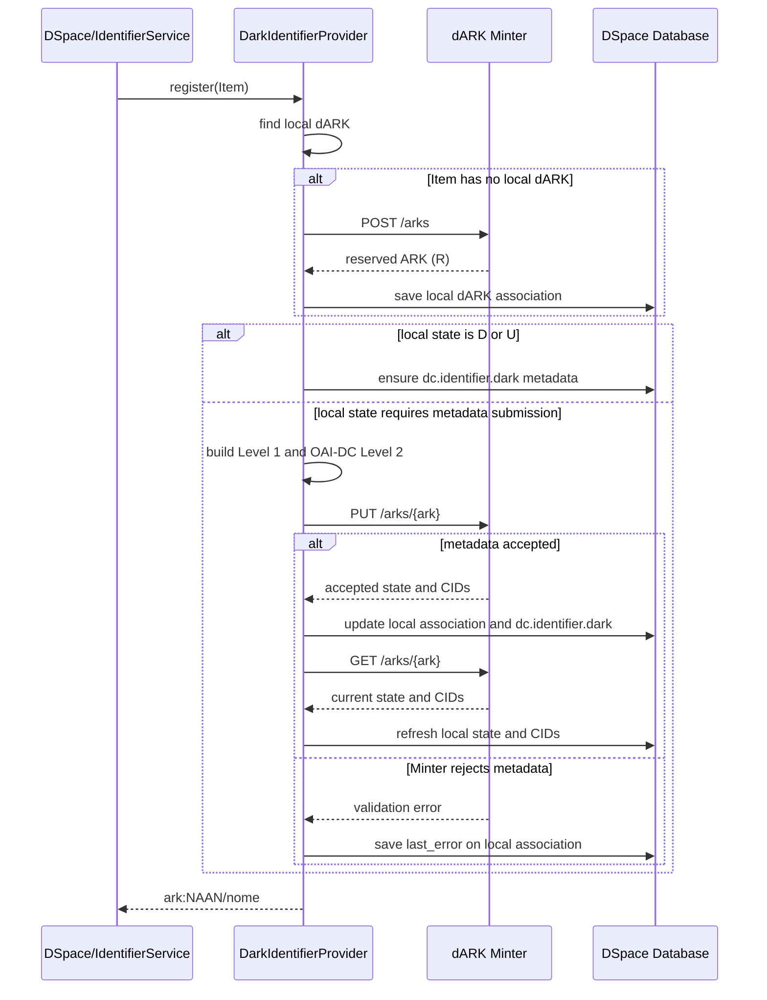
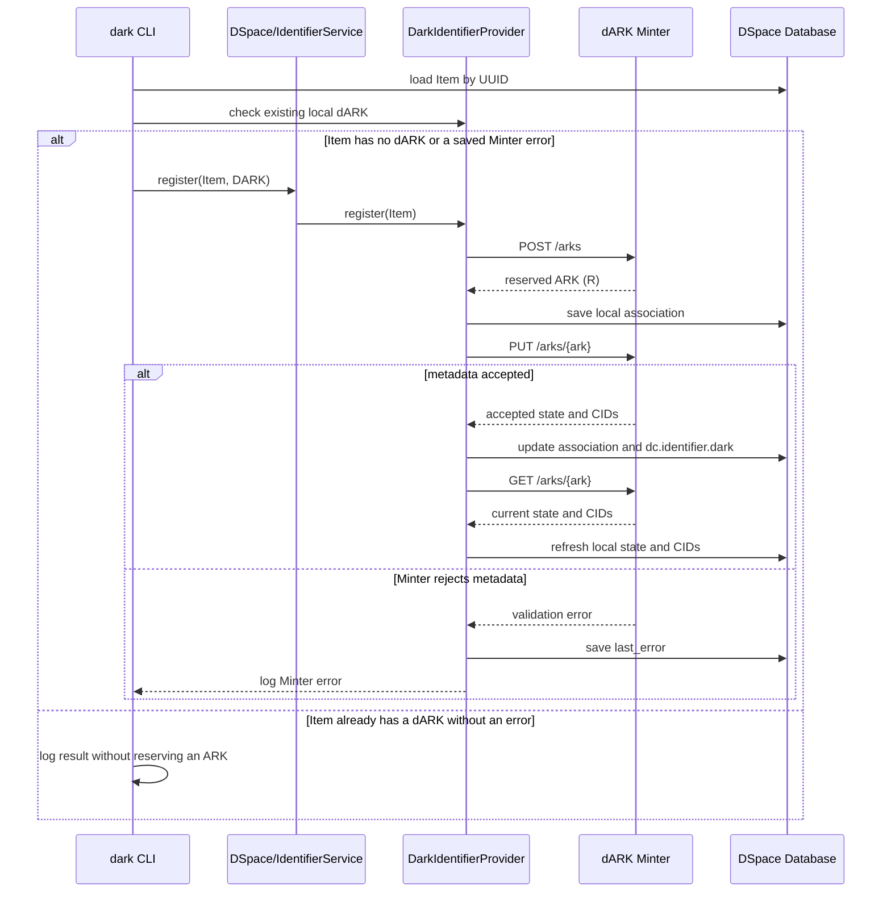
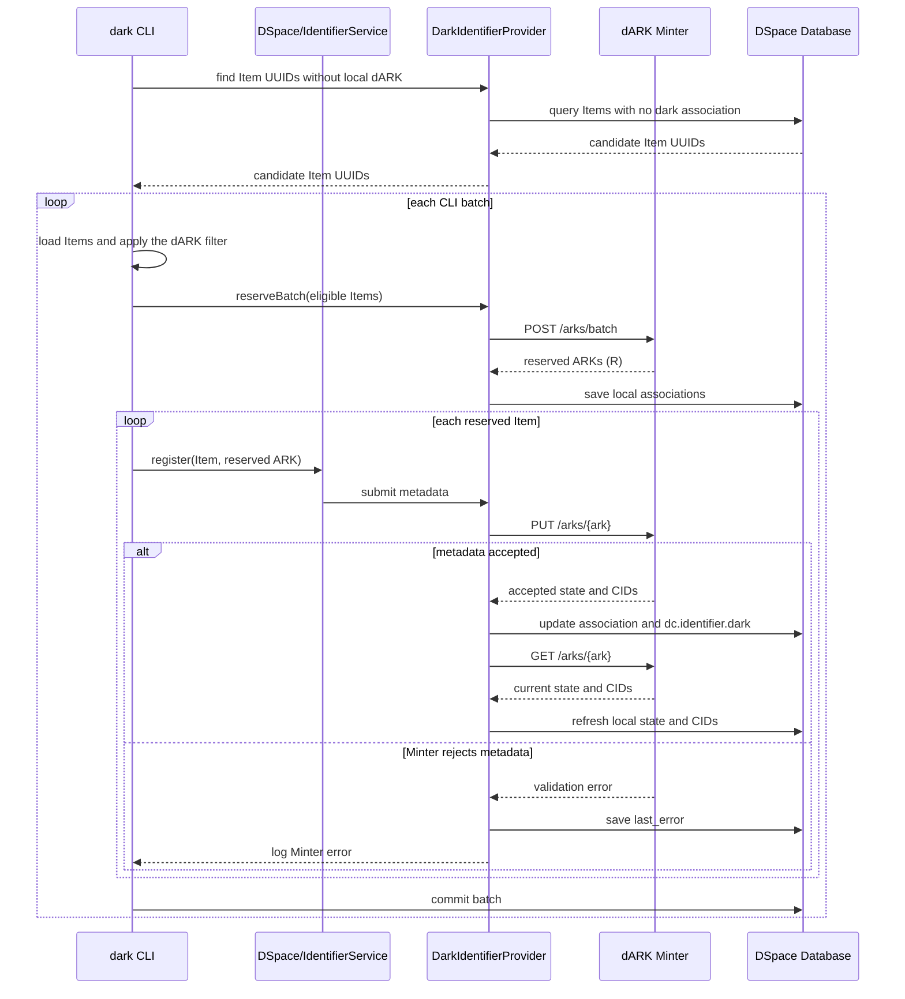
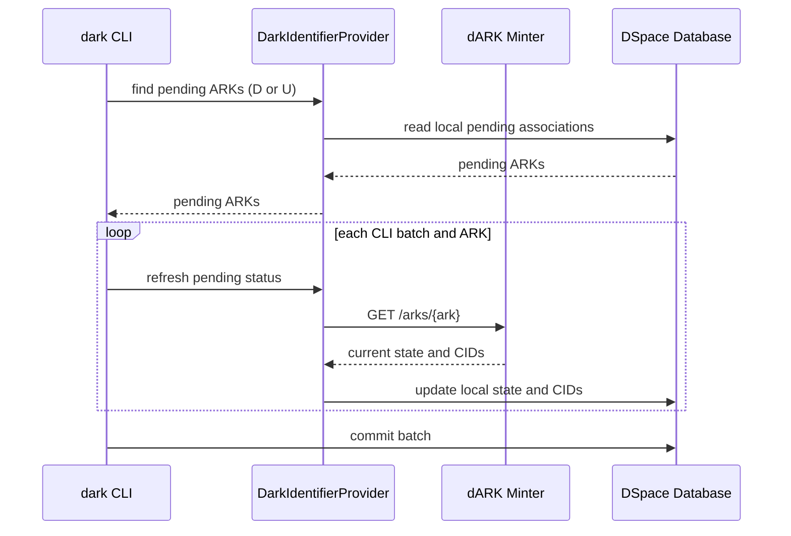
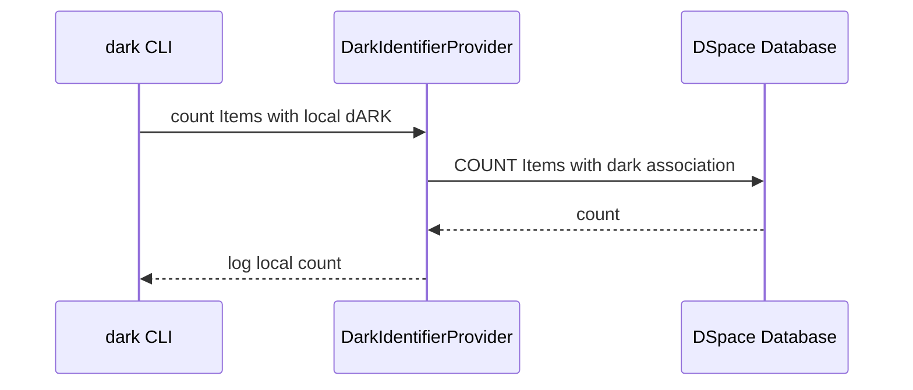

# dARK Integration for DSpace

## Purpose

This implementation adds native support for dARK persistent identifiers to
DSpace. It follows the DSpace identifier provider pattern, preserves the
internal Handle, and integrates the repository only through the dARK Minter
HTTP API. No files in the dARK project are modified by this integration.

dARK identifiers can be assigned automatically to new Items or, for existing
Items, through the `dark` administrative command.

## Components

The integration has five parts:

1. `DarkIdentifierProvider` implements the identifier lifecycle in the DSpace
  `IdentifierService`.
2. `DarkClientImpl` communicates with the dARK Minter API.
3. `DarkMetadataBuilder` transforms Item metadata into API-compatible Level 1
  and OAI-DC Level 2 metadata.
4. `DarkService` and `DarkDAO` persist the local association between an Item
  and a dARK.
5. `dark` assigns dARKs to existing Items idempotently.

## Configuration

The source configuration is in `dspace/config/modules/dark.cfg`. After
installation, the effective configuration is in
`[dspace.dir]/config/modules/dark.cfg`. Update the effective copy and restart
DSpace after changing settings used by the server.

```properties
identifier.dark.enabled = true
identifier.dark.minter-api-url = http://localhost:8001/api/v1
identifier.dark.batch-size = 100
identifier.dark.authority-id = platform-demo-1788435035
identifier.dark.naan = 12345
```

The authority and NAAN must exist and be provisioned in the dARK platform
before the first assignment. The bearer token is optional and is only needed
when the API is protected by HTTP authentication:

```properties
#identifier.dark.api-token =
identifier.dark.authority-header.enabled = true
identifier.dark.authority-header = X-Authority-Id
```

In production, authority identity should use mTLS. The authority header exists
for local profiles in which the Minter accepts it.

### Identifier metadata

```properties
identifier.dark.metadata = dc.identifier.dark
```

The dARK is written only to the field configured in
`identifier.dark.metadata`, in compact form such as `ark:12345/2000000004k`.
It does not replace the Handle, `dc.identifier`, or `dc.identifier.uri`.

### Metadata mapping

The fields accept an ordered, comma-separated list. Every field in the list is
read, rather than only the first one. This supports collections using different
Dublin Core profiles.

```properties
identifier.dark.metadata.title = dc.title
identifier.dark.metadata.creator = dc.creator, dc.contributor.author, dc.contributor
identifier.dark.metadata.date = dc.date, dc.date.issued
identifier.dark.metadata.publisher = dc.publisher
identifier.dark.metadata.type = dc.type
identifier.dark.metadata.language = dc.language.iso
identifier.dark.metadata.abstract = dc.description.abstract
identifier.dark.metadata.subject = dc.subject
```

For Level 1, the Minter validates its own required fields, such as title,
author, and year. DSpace sends every configured value and does not prevalidate
these requirements. A Minter rejection is logged and stored in the local
`dark.last_error` column for correction and retry.

List order determines the order of values sent.

## Automatic flow when creating an Item

When `IdentifierService` registers identifiers for an Item,
`DarkIdentifierProvider` participates in the flow if
`identifier.dark.enabled = true`. It ignores objects that are not Items and
makes no external calls while disabled.



DSpace stores the canonical compact form `ark:12345/name`. It accepts the
legacy slash form `ark:/12345/name` at the provider boundary and normalizes it
before persisting, avoiding duplicate local records caused by format
differences.

The payload sent to the Minter contains Level 1 metadata, an alternate
identifier with the Item UUID, the target URL, and an OAI-DC representation for
Level 2. After accepting the `PUT`, the Minter publishes asynchronously. The
provider immediately performs one `GET /arks/{ark}` and persists the most
recent state and CIDs. If it already observes `PUBLISHED` (`P`), the local
association is marked as published. A `DRAFT` (`D`) or `UPDATE` (`U`) response
is valid and does not block Item registration; a temporary read failure is
logged as a warning and does not undo the accepted metadata update.

If the Minter rejects metadata during the automatic flow, DSpace retains the
local reserved ARK and records the response in `dark.last_error`. After
correcting the Item, an administrator can retry it with `--mint-uuid`.

## Command-line assignment

The script is registered as `dark` and requires the provider to be enabled.
Run it from the DSpace installation directory:

```bash
bin/dspace dark --mint-uuid <uuid-do-item>
bin/dspace dark --mint-all
bin/dspace dark --refresh-status
bin/dspace dark --refresh-uuid <uuid-do-item>
bin/dspace dark --count-local
```

The options are mutually exclusive.

### `--mint-uuid`

Processes one Item. It checks for an existing local dARK and retries the same
ARK when its local association contains a Minter error.



### `--mint-all`

Queries only Items without a local dARK association. Items are reserved in
batches of `identifier.dark.batch-size`; each reserved Item is then registered
individually and the Minter validates its metadata.



At the end of `--mint-all`, the script reports counts for `minted`, `already assigned`,
and `failed`. A failure for one Item does not stop the traversal; at the end,
the command exits with an error if any failure occurred.

### `--refresh-status`

Reads pending local dARKs in `DRAFT` (`D`) or `UPDATE` (`U`) and refreshes their
state from the Minter. It neither reserves identifiers nor submits metadata.



`--refresh-status` uses `identifier.dark.batch-size` to commit local updates
per batch. The dARK API currently exposes status only per ARK, so each batch
still performs one `GET /arks/{ark}` request for each pending ARK. It reports
the number of dARKs checked, published, still pending, and failed. It can be
run repeatedly by an administrator or a cron job until pending records reach
`PUBLISHED`.

### `--refresh-uuid`

Refreshes the Minter state for one Item's existing local dARK association. It
is used by the administrative UI for Item rows in `D` or `U` state and does not
reserve an ARK or submit metadata.

### `--count-local`

Counts Item associations in the local `dark` table. It does not call the dARK
Minter API and does not modify data.



Example Minter validation error for an Item without a title:

```text
dARK Minter rejected Item <uuid>: dARK API returned HTTP 422: title is required
```

The same message is stored in `dark.last_error`. After correcting the Item,
run `bin/dspace dark --mint-uuid <uuid-do-item>` to submit metadata again for
the existing reserved ARK.

## Local persistence

The migration creates the sequence and `dark` table. Each row associates an
`Item` with a unique ARK and stores, among other data, its state,
`client_item_id`, target URL, metadata CIDs, and the last Minter error message.
Indexes support lookups by ARK and DSpace object.

The `dark.status` column stores the dARK Minter state code directly: `R`
(reserved), `D` (draft), `U` (update), `P` (published), or `T` (tombstone).
Migrations are provided for PostgreSQL and H2. They must be applied through the
standard DSpace update process before enabling the provider in a new database.

The table does not contain `resource_type_id` or `tombstone_requested`. dARK
records are Item associations, and DSpace does not request tombstoning from the
dARK platform. If a status refresh returns `T`, DSpace retains that state and
does not expose the dARK as an active local identifier.

## Administrative web UI

Site administrators can open `/admin/darks` to inspect the local dARK registry.
The UI uses the protected `GET /api/admin/darks` endpoint and supports filters
by ARK, status, Item UUID, and saved Minter error; creation/update date sorting;
pagination; and CSV export through `GET /api/admin/darks/export`.

The "Items without dARK" view lists only Items with no local association. Its
bulk action starts the existing `dark --mint-all` script as a DSpace process.
Row actions also start DSpace processes: `--mint-uuid` retries records with a
saved Minter error, and `--refresh-uuid` refreshes an individual `D` or `U`
record. Published (`P`) records have no UI action.

The web API intentionally exposes only the fields needed for administration:
ARK, Item UUID, state, target, last error, and timestamps. Internal client IDs
and CIDs remain stored locally but are not returned by this endpoint.

## Deployment and verification

1. Configure `dark.cfg` in the source and effective installation.
2. Run the DSpace database update to apply the `dark` migration.
3. Build and install the DSpace artifact normally.
4. Restart the DSpace server.
5. Test one Item first using `bin/dspace dark --mint-uuid ...`.
6. Only then run `bin/dspace dark --mint-all` for legacy content.

For a focused build during development:

```bash
mvn -pl dspace-api clean package \
  -DskipUnitTests=true -DskipIntegrationTests=true \
  -Dmaven.compiler.useIncrementalCompilation=false
```

Focused unit tests use `-DskipUnitTests=false`, but the environment must have
the `org.dspace:dspace-parent:zip:testEnvironment:11.0-SNAPSHOT` artifact
available locally.

## Safe operation

- Keep `identifier.dark.enabled = false` until the authority, NAAN, and API are
  ready.
- Test with `--mint-uuid` before bulk processing.
- Fix metadata for skipped Items and run the same command again; the flow is
  idempotent for Items that already have a dARK.
- Do not modify the dARK repository or API to adapt DSpace formats; format
  compatibility is handled by the DSpace client.
